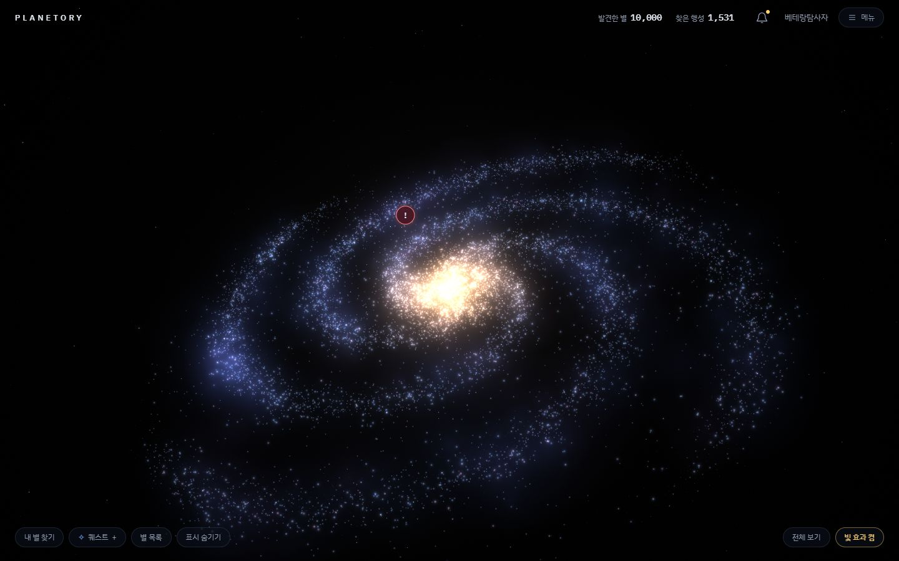
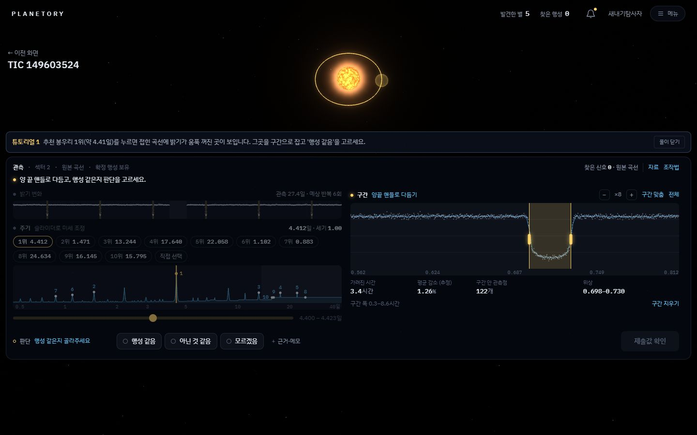
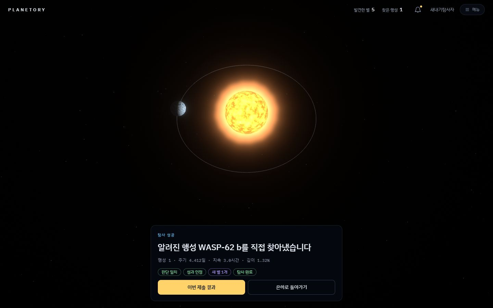
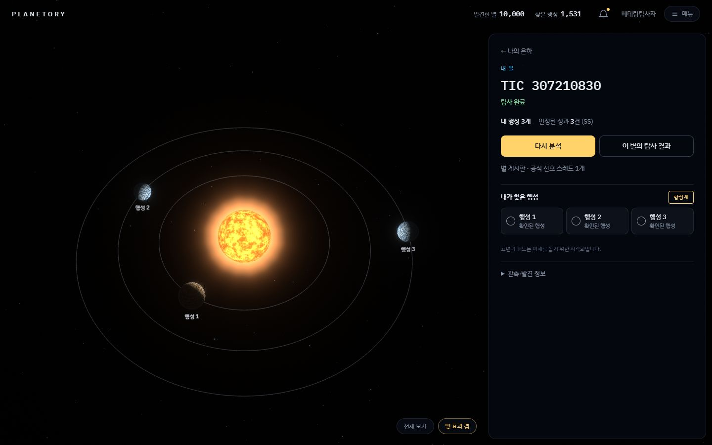
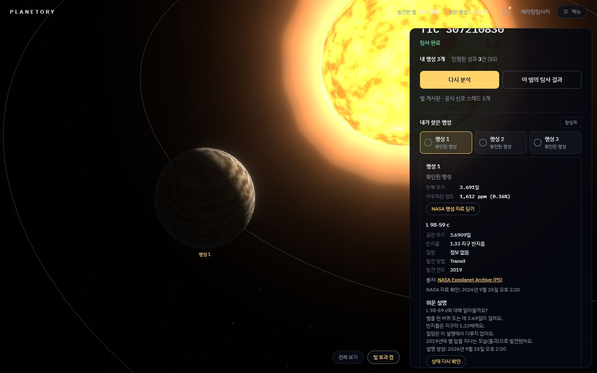
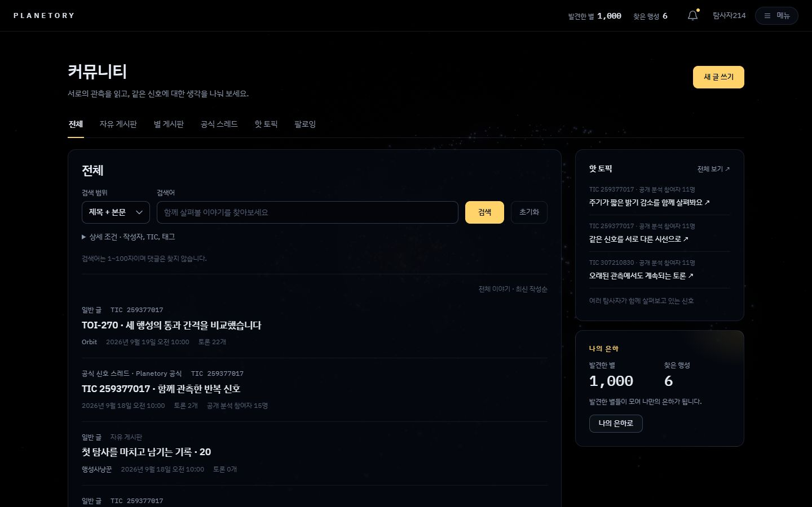
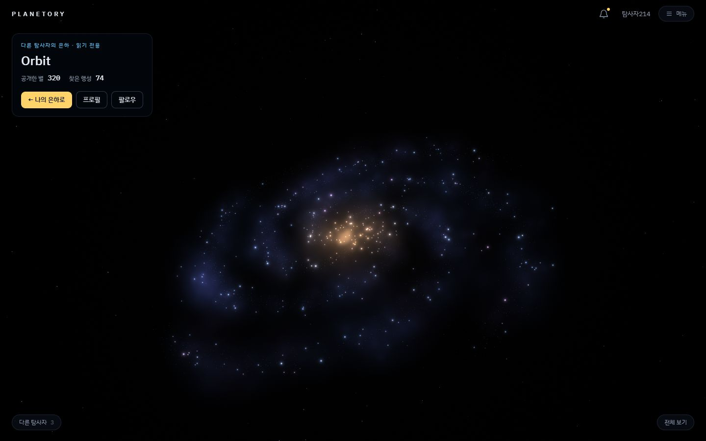
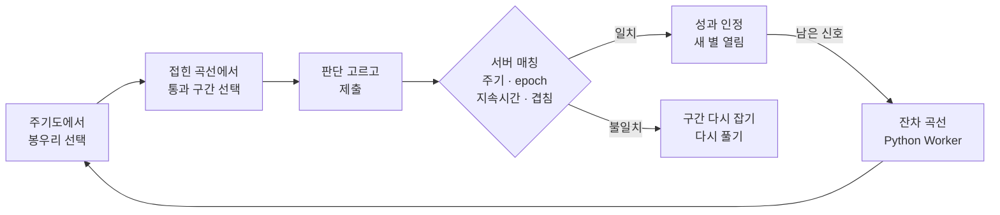
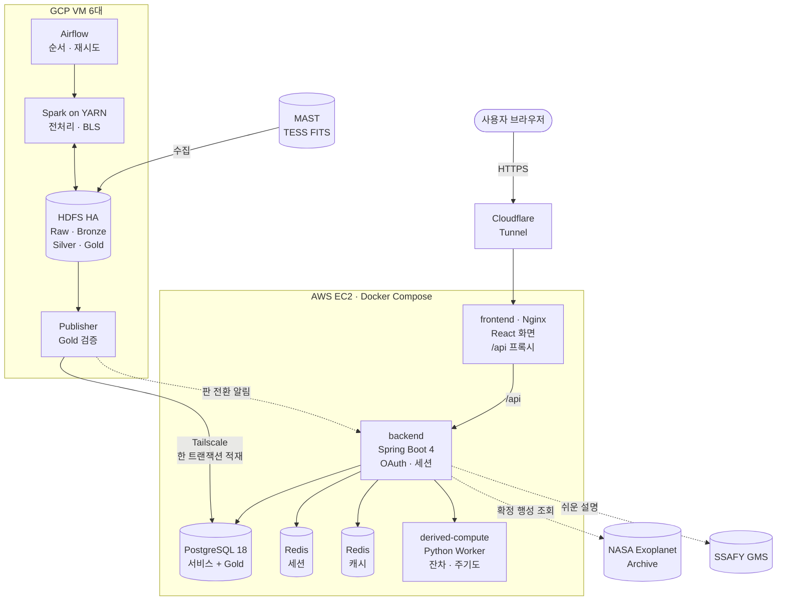

<div align="center">

# Planetory

**별을 발견할 때마다 당신의 은하가 자랍니다**

NASA TESS 관측 광도곡선에서 사용자가 직접 주기와 통과 구간을 골라 외계행성 신호를 찾고,
찾은 별과 행성이 나만의 3D 은하로 쌓이는 웹 서비스입니다.

SSAFY 15기 특화 프로젝트(빅데이터 분산) · 2026.08 ~ 2026.09 · 6인

`React 19` `TypeScript` `Three.js` `WebGL2` `Spring Boot 4` `PostgreSQL 18` `Redis 7` `Hadoop 3.5` `Spark 3.5` `Airflow 2.10` `Docker Compose` `GitLab CI`

</div>

<br />



> 발표 시연 서버에서 찍은 화면입니다. 은하의 별 수와 회원 이름은 합성 자료이고, 튜토리얼 · 탐사 별 10개만 실제 TESS 관측 자료입니다.

<br />

## 목차

1. [왜 만들었나](#왜-만들었나)
2. [주요 기능](#주요-기능)
3. [탐사는 이렇게 진행됩니다](#탐사는-이렇게-진행됩니다)
4. [아키텍처](#아키텍처)
5. [기술 스택](#기술-스택)
6. [데이터와 출처](#데이터와-출처)
7. [성능 측정과 개선](#성능-측정과-개선)
8. [테스트 · 배포](#테스트--배포)
9. [실행 방법](#실행-방법)
10. [저장소 구조](#저장소-구조)
11. [팀과 역할](#팀과-역할)
12. [내가 맡은 일](#내가-맡은-일)
13. [한계와 다음 단계](#한계와-다음-단계)

<br />

## 왜 만들었나

TESS 망원경의 관측 광도곡선은 MAST에 공개돼 있습니다. Planetory는 외계행성 탐색의 진입 장벽을 낮춰, 누구나 이 실측 자료를 분석하고 탐색에 참여하게 하는 것을 목표로 했습니다.

원본 수집 · 전처리 · 신호 탐색(BLS)은 GCP 분산 배치가 미리 해 두고, 서비스는 검증된 결과만 읽습니다. 사용자는 다음 순서로 진행합니다.

```
로그인 → 나의 은하 → 별 선택 → 분석(주기 → 통과 구간 → 판단) → 제출 · 매칭 → 발견 → 새 별이 열려 은하가 자람
```

- 처음 다섯 별은 답이 있는 튜토리얼(WASP-62, L 98-59 등 실제 별)입니다
- 아직 확인되지 않은 신호는 개인 기록으로 남기고, 커뮤니티에 분석을 공개해 함께 토론합니다

<br />

## 주요 기능

### 처음 온 탐사자 — 튜토리얼 별에서 첫 행성 찾기

| 분석 | 발견 카드 |
|---|---|
|  |  |

- SSAFY · Google 로그인 뒤 짧은 소개를 보고 튜토리얼 1번 별(WASP-62)로 날아가 분석 시작
- 밝기 변화 · 주기도에서 봉우리(1 ~ 10위)를 고르면 접힌 곡선이 나오고, 통과 구간을 드래그로 잡으면 가려진 시간 · 평균 감소 · 위상을 바로 보여 줍니다
- 판단(행성 같음 · 아닌 것 같음 · 모르겠음)과 제출값 확인 뒤 제출
- 일치하면 통과 장면과 발견 카드, 은하로 돌아오면 새 별이 켜집니다
- 구간이 빗나가면 "구간 다시 잡기 · 주기 다시 고르기"로 다시 시도

### 나의 은하 · 항성계

| 항성계 | NASA 행성 자료 |
|---|---|
|  |  |

- 발견한 별이 3D 나선 은하로 쌓이고, 전체 보기 · 별 목록 · 퀘스트(튜토리얼 · 챌린지) 제공
- 별을 누르면 항성계로 날아가 내가 찾은 행성만 공전합니다
- 확인된 행성은 NASA Exoplanet Archive 수치(공전 주기 · 반지름 · 발견 방법 · 연도)와 한국어 "쉬운 설명"을 출처와 함께 표시
- 이 별의 탐사 결과, 마이페이지(내 별 · 분석 기록 · 통계)
- WebGL을 쓸 수 없으면 별 목록 대체 화면, 그래픽이 느리면 빛 효과 끄기 · 저사양 단계

### 커뮤니티 · 다른 탐사자의 은하

| 커뮤니티 | 다른 탐사자의 은하 |
|---|---|
|  |  |

- 전체 · 자유 게시판 · 별 게시판 · 공식 스레드 · 핫 토픽 · 팔로잉 탭, 검색과 상세 조건(작성자 · TIC · 태그)
- 글에 내 분석 기록 첨부, 댓글 · 반응
- 글쓴이 프로필에서 팔로우, "은하 방문하기"로 다른 탐사자의 은하를 읽기 전용으로 둘러보기

<br />

## 탐사는 이렇게 진행됩니다



- 브라우저가 고른 주기로 곡선을 접고, 통과 구간에서 epoch · 지속시간을 미리 보여 줍니다
- 서버가 epoch · 지속시간을 다시 계산해, 배치가 미리 찾아 둔 후보 신호(자체 BLS)와 주기 · epoch · 지속시간 · 통과 구간 겹침이 모두 맞는지 봅니다. 고조파는 1/2배 · 2배만 인정합니다
- 사용자의 판단은 수치 매칭 결과를 바꾸지 않고 따로 기록합니다
- 신호가 여러 개인 별은 찾은 신호를 지운 잔차 곡선 · 주기도를 Python Worker가 요청 때 계산합니다. 계산 상태 · 결과 · 잠금은 Backend가 Redis로 관리합니다
- 고유 신호 성과가 인정될 때마다 새 별이 열립니다

<br />

## 아키텍처



- **온라인과 배치 분리**: EC2는 서비스, GCP는 저장 · 배치 처리를 맡습니다. 서비스는 HDFS를 실시간으로 읽지 않고, GCP 결과는 검증된 묶음(PublicationBundle)으로만 PostgreSQL에 적재합니다
- **데이터 계층**: Raw(FITS 원본) → Bronze(Sector Parquet) → Silver(정제 곡선 · BLS · 잔차) → Gold(게시 후보). Publisher가 적재와 현재 판 전환을 한 트랜잭션으로 처리하고, 실패하면 롤백해 기존 판을 유지합니다
- **외부 인바운드 포트 0개**: 공개는 Cloudflare Tunnel만, 서버 간 · CI 배포 경로는 Tailscale을 씁니다
- **Redis 두 개**: 캐시 축출이 로그인 세션을 지우지 않도록 세션 · 캐시를 나눴습니다. 백엔드는 두 주소가 같으면 기동을 거부합니다
- **격리**: 계산 Worker는 DB에 직접 접속하지 않고 Backend가 넘긴 배열 · 고정 모델로만 계산합니다. DB 계정은 소유자(Flyway) · 앱 런타임 · Gold 적재로 나눴고, 스키마는 Flyway(V1 ~ V30)로만 바꿉니다
- **GCP 클러스터**: NameNode Active/Standby(QJM), DataNode 5대 · 복제 2, YARN 위 Spark cluster mode

<br />

## 기술 스택

| 영역 | 기술 |
|---|---|
| Frontend | React 19.2, TypeScript 7.0, Vite 8.2, React Router 7.18, three.js 0.186(운영 화면), WebGL2 직접 렌더러(별지도) |
| Backend | Java 21, Spring Boot 4.1.1, Spring Security(OAuth2 Client: SSAFY · Google), Spring Session Data Redis, Spring Data JPA + JdbcClient, Flyway, springdoc-openapi, Spring AI 2.0(OpenAI 호환), Gradle 9.7 |
| 계산 Worker | Python 3.12, numpy · scipy · astropy 7.2, 공용 커널 `libs/astro-kernel` |
| Data | PostgreSQL 18.6, Redis 7.4 × 2(세션 · 캐시) |
| 분산 처리 | GCP Compute Engine 6대, Hadoop 3.5.0(HDFS HA · YARN), Spark 3.5.5, Airflow 2.10.5 |
| Infra | AWS EC2(Ubuntu 24.04), Docker Compose, Nginx 1.27, Cloudflare Tunnel, Tailscale, GitLab CI(자체 Runner · `registry:3`), Jira |
| Test | JUnit 5 · Testcontainers, Node test runner(tsx), Playwright 1.63, Python unittest · pytest |

<br />

## 데이터와 출처

| 자료 | 제공처 · 용도 |
|---|---|
| TESS 광도곡선(FITS), TCE 목록 | MAST(STScI). 배치 원천 수집, 시연용 실제 별 10개 |
| 확정 행성 정보 | NASA Exoplanet Archive TAP. 별 패널의 "NASA 행성 자료", 배치 외부 원천(`toi` · `pscomppars`) |
| TOI 목록 | ExoFOP-TESS. 후보 판정의 외부 참고값 |
| 행성 쉬운 설명 | SSAFY GMS(OpenAI 호환). 확정 행성의 NASA 수치를 한국어 설명으로 생성 |

**첫 운영 배치 처리 규모(2026.09.21 ~ 09.27)**

| 단계 | 결과 |
|---|---|
| Raw(HDFS) | Sector 1 ~ 13 FITS 247,824개 · 441.62 GiB |
| Silver(전처리 · 반복 BLS) | 별 128,258개, 약 30시간 |
| Gold 게시 준비 | 별 4,916개 · 후보 신호 5,154개 |
| 서비스 공개 | 별 2,379개(배치 2,374 + 튜토리얼 5) |

- 원본 FITS는 Git에 넣지 않고 HDFS에만 둡니다
- 저장소의 DB 덤프에는 튜토리얼 · 챌린지 별 10개와 그 Gold만 있고, 회원 · 제출 · 게시글은 넣지 않았습니다

<br />

## 성능 측정과 개선

개인 은하 지도에 별이 10만 개일 때 화면을 움직이면 끊기는 문제를 개선했습니다(Jira S15P21C206-215, 9/18 · 9/20 두 차례 develop 병합).

**측정 조건**
- 같은 PC(Intel Arc 그래픽), Chrome 153, 1440px · DPR 1, 같은 자료(별 100,000개 · 행성 5,000개, 데이터 SHA-256 동일)
- 당시 서비스 화면(라우터 · 지도 · 퀘스트 · 별 상세)을 운영 빌드로 띄우고, 서버 응답만 로컬 합성 서버로 대체
- 합격 기준: 프레임 간격 p95 16.7ms 이하 · 최악 33ms 이하 · JS 힙 300MB 이하

**바꾼 것**
- 타일 데이터: 같은 타일 범위 안의 카메라 이동은 진행 중 요청을 취소하지 않고, 완료된 타일 집합 4개까지 배열 · 별 객체 재사용
- 가시 영역 계산: 별 배열의 경계 트리를 재사용해, 화면 안팎이 확실한 영역은 한 번에 판정하고 경계의 별만 투영
- GPU 업로드: float32 속성을 한 번 준비해 두고 보이는 구간만 복사, 바뀐 구간은 `bufferSubData` 한 번으로 반영
- 별 하나 그리기: 인스턴스당 정점 6개 → 4개(triangle strip)
- 정지 배경: 별 배경을 캔버스 크기 RGBA8 버퍼에 보관하고 다음 프레임은 픽셀 복사(`blitFramebuffer`), 움직이는 행성 · 궤도만 다시 그림
- 클릭 판정: 월드 쿼드트리로 포인터 주변 별만 투영
- 별 수 · 좌표 · 색 · 크기는 그대로(군집 · 표시 상한 없음). 12개 카메라 · 선택 조합에서 개선 전후 화면의 픽셀 차이 0

| 항목 | 개선 전(9/18) | 개선 후(9/20) |
|---|---:|---:|
| 키보드 이동 프레임 간격 p95 | 291.8 ms | **8.4 ms** |
| 키보드 회전 p95 | 283.6 ms | **8.4 ms** |
| 휠 확대 p95 | 241.8 ms | **8.5 ms** |
| 확대 상태 이동 p95 | 142.0 ms | **8.5 ms** |
| JS 힙 최고치 | 451.1 MB | **169.8 MB** |
| 전체 별 적재 | 6.89 초 | **5.04 초** |
| 첫 별 표시 | 245 ms | 303 ms |

> 첫 별 표시는 오히려 늦어졌습니다(목표 2초 안). 개인 PC에서 합성 응답으로 잰 로컬 측정이며 배포 환경 결과가 아닙니다. Firefox는 16개 구간 중 1개가 최악 기준을 넘었고(41.68ms), Safari와 Firefox 메모리는 확인하지 못해 성능 전체 합격으로 처리하지 않았습니다. 측정 대상은 당시 서비스 화면의 WebGL2 별지도이고, 9/27부터 운영 기본이 된 시네마 화면(three.js)은 이 측정에 포함되지 않습니다.
>
> 기록: [측정 방법](apps/frontend/docs/performance-215.md), [인수 기록](apps/frontend/docs/ticket-215-readiness.md), [원시 결과 해시 · 수치](apps/frontend/docs/performance-215-evidence.json)

<br />

## 테스트 · 배포

```
feature 브랜치 → MR(비작성자 승인 1명) → develop 병합
  MR      : validate:*(Compose · Hadoop 설정 · 데이터 계약 · astro-kernel · 데이터 플랫폼)
            backend:build · web:build(타입 검사 · 번들 · 단위 테스트) · *:image(푸시 없는 빌드)
  develop : build:frontend · build:backend · build:derived-compute(이미지 push)
            backend:test(Testcontainers) · web:e2e:smoke 자동
  배포    : deploy:<앱>(수동) → deploy.sh가 이미지 교체 · 헬스 확인 · 실패 시 직전 이미지로 되돌림
```

- 백엔드 배포 전에는 DB 덤프를 남기고(최근 10개), Flyway는 앞으로만 적용합니다
- 브라우저 테스트(Playwright)는 스모크만 develop 병합 뒤 자동으로 돌고, 전체(505개)는 수동입니다
- lab.ssafy.com 컨테이너 레지스트리가 꺼져 있어 CI 노드에 자체 `registry:3`을 운영했습니다
- GCP 배치 코드는 CI 이미지가 아니라 운영자 스크립트가 불변 release 디렉터리로 설치합니다
- 발표 이후(10/02) 서비스 · CI 노드를 ARM64 서버로 옮겨, 현재 CI는 앱 이미지를 `linux/arm64`로 빌드합니다

<br />

## 실행 방법

### A. 발표 시연 서버로 바로 보기(권장)

백엔드 · DB 없이 합성 자료로 로그인부터 새 별 점화까지 동작합니다. Node 22.12 이상, 그래픽 가속을 켠 Chrome, 폭 1024px 이상 화면이 필요합니다.

```bash
cd apps/frontend
npm ci
npm run dev:cinema
# 처음 온 탐사자 시나리오
# http://127.0.0.1:58390/api/dev-cinema/session?as=newcomer&start=login
```

- 실제 TESS 별 10개를 쓰려면 `tools/real-sample/README.md`로 `apps/frontend/.real-sample/`을 먼저 만듭니다(MAST에서 FITS 24개 · 약 48MB). 없으면 모두 합성 자료입니다. 화면 위 가운데 `DEMO` 탭(`Alt+Shift+D`)에서 계정 · 은하 크기를 고릅니다

### B. 서비스 전체를 운영과 같은 방식으로 띄우기

```bash
docker build --platform linux/amd64 -f apps/backend/Dockerfile -t planetory/backend:local .
docker build --platform linux/amd64 -f apps/frontend/Dockerfile -t planetory/frontend:local \
  --build-arg VITE_SKY_RENDERER_ENABLED=true --build-arg VITE_CINEMA=true .
docker build --platform linux/amd64 -f apps/derived-compute/Dockerfile -t planetory/derived-compute:local .

cd infra/service          # .env 작성: 이미지 이름 · DB 비밀번호 · OAuth(포팅 매뉴얼 4.3)
docker compose up -d service-db session-redis cache-redis
docker compose up -d derived-compute backend frontend
# http://localhost:3000
```

빈 DB에서는 가입이 되지 않습니다(가입 때 튜토리얼 1번 별을 지급). [DB 덤프](exec/3-db-dump/README.md)의 스키마 → 데이터 순서로 복원하면 튜토리얼 · 챌린지 별 분석까지 됩니다. 로그인에는 SSAFY 또는 Google OAuth 자격 증명이 필요합니다.

- 빌드 · 배포 전체 안내: [exec/1-porting-manual.md](exec/1-porting-manual.md)
- 외부 서비스 설정: [exec/2-external-services.md](exec/2-external-services.md)
- 시연 순서: [exec/4-demo-scenario.md](exec/4-demo-scenario.md)

<br />

## 저장소 구조

```
apps/frontend/         React 화면 (src/cinema: three.js 운영 화면, src/features: WebGL2 별지도 · 분석 · 커뮤니티)
apps/backend/          Spring Boot API (domain: auth · member · exploration · gold · post · comment · statistics)
apps/derived-compute/  Python 잔차 · 주기도 Worker
libs/astro-kernel/     전처리 · BLS · transit 모델 공용 커널 (Spark · Worker가 함께 사용)
distributed-system/    ingestion(MAST 수집) · spark(Bronze · Silver · Gold) · airflow(DAG) · publisher(Gold 적재)
contracts/             Gold 게시 · 파생 계산 데이터 계약과 검사기
infra/                 EC2 서비스 Compose · 배포 스크립트, GCP Hadoop/YARN 설정 · VM 생성
experiments/           PoC (은하 지도, 분석 UI, BLS · AstroNet 벤치마크)
tools/real-sample/     시연용 실제 TESS 표본 생성
docs/                  요구사항 · 아키텍처 · 운영 · 변경 이력 · KPT
exec/                  SSAFY 제출 포팅 매뉴얼 · DB 덤프 · 시연 시나리오
```

<br />

## 팀과 역할

| 이름 | 역할 |
|---|---|
| **하서진** | 지도 · 서비스 Frontend(3D 별지도, 튜토리얼 · 퀘스트, 커뮤니티, 마이페이지), 시네마 화면 |
| 백지웅 | 분석 Frontend(광도곡선 · 주기도 · 위상 접기, 제출, 결과 화면) |
| 강재민 | 탐사 코어 Backend(Gold 조회, 제출 · 매칭, 성과 · 등급, 온라인 잔차 계산) |
| 백승학 | 서비스 Backend(인증 · 회원, 커뮤니티, 통계, 알림) |
| 윤성용 | 천문 데이터 처리 · AI(전처리, BLS, transit 모델, 외부 카탈로그, AI 평가) |
| 김동혁 | 데이터 플랫폼 · DevOps(GCP · HDFS · YARN/Spark · Airflow, Gold 전달) |

<br />

## 내가 맡은 일

> Claude Code · Codex 같은 AI 코딩 도구로 구현하고, 결과는 테스트 · 코드 리뷰 · 실제 브라우저 확인으로 검증했습니다.

**사용자 입장에서 화면 고르기**
- 서비스를 직접 여러 번 쓰며 UI · 연출 · 그래픽만으로 무엇을 하는 서비스인지 이해되는지를 기준으로 살폈습니다. AI와 화면을 다듬고, 써 보며 방향을 골랐습니다
- 은하 한 장면 위에서 로그인 → 은하 → 별 → 항성계 → 분석 → 통과 장면 → 발견 → 새 별 점화가 화면 전환 없이 이어지는 시네마 화면(three.js)을 실험 브랜치로 만들어 제안
- 사용자 관점 수정: 첫 로그인 이야기 · 튜토리얼 화면, 주기 다시 고르기 · 구간 다시 잡기, 내부 ID · 긴 숫자 정리, 알려진 행성 표현, 발견 연출 건너뛰기, 아직 열지 않은 새 별 표시
- 팀이 새 분석 화면을 채택했고, 시네마 화면은 운영 기본 화면이 되었습니다
- 실제 TESS 별 10개를 팀 커널로 처리해 시연 서버에 넣는 도구(`tools/real-sample`)

**Frontend — 별지도 · 서비스 화면**
- 공통 기반: 라우터 · API 클라이언트 · CSRF, SSAFY · Google 로그인 · 인증 게이트 · 로그아웃, OAuth 일시 장애와 인증 실패 안내 분리
- 별지도: 메타 · 타일 · 버전 로딩, 개별 별 WebGL 렌더링과 실제 API 연결, 지도 조작 · 별 선택 · 마커 접근성, 별 상세 · 내 행성 확대, WebGL 실패 시 별 목록 대체 화면
- 튜토리얼 · 챌린지 · 재개 퀘스트 패널, 분석 사용법 GIF 안내
- 커뮤니티: 전체 피드 · 공식 신호 스레드, 글 · 댓글 작성과 응답 유실 복구, 반응, 내 분석 기록 첨부, 프로필 · 닉네임, 검색 · 필터, 핫 토픽
- P1: 팔로우, 알림함, 공개 · 알림 설정, 회원 탈퇴 확인 화면, 별 검색, 다른 탐사자의 공개 은하 방문
- 설계: 은하형 별지도 PoC, 별지도 표현 명세(은하형 배치, 군집 대신 개별 별 유지, 선택한 별의 내 행성만 공전)

**성능**
- 10만 별 지도의 이동 · 메모리 개선([위 표](#성능-측정과-개선)). 원인 탐색 · 코드 개선 · 측정은 AI 에이전트가 수행했고, 측정 기록과 미달 항목을 저장소에 남겼습니다

**협업**
- 팀원의 로그인 MR을 명세 · 실제 동작과 비교해 첫 별 좌표 저장 · DB 초기화 안내 문제를 댓글로 전달
- 다른 팀원 MR 25건을 develop에 병합(비작성자 승인 규칙)

<br />

## 한계와 다음 단계

- 서비스 인스턴스가 한 대이고 PostgreSQL 대기 서버 · 백업이 없습니다. 서버 장애는 전면 중단이고, 회원 · 제출 · 커뮤니티 데이터는 사본이 없습니다(Gold는 HDFS 백업으로 다시 게시 가능)
- 10만 별 성능은 Firefox의 단발 지연 원인을 확정하지 못했고, Safari와 실제 배포 환경 측정이 남았습니다. 9/27 이후 운영 화면(three.js)은 이 측정 범위 밖이라 같은 조건의 측정이 필요합니다
- AI 후보 판별 모델(AstroNet)은 평가까지 했지만, 오탐 · 누락 허용 기준 미확정 · 작은 표본 · 라이선스 검토 때문에 운영 채택을 보류했습니다
- 첫 게시에서 보류(held)된 별 17,788개는 공개되지 않았습니다. Sector 14 이후 증분 Silver는 일부(Sector 14, 버킷 2개)만 실행했고, 긴 관측 기간의 BLS 주기 격자를 확인한 뒤 Gold 게시에 연결할 계획입니다
